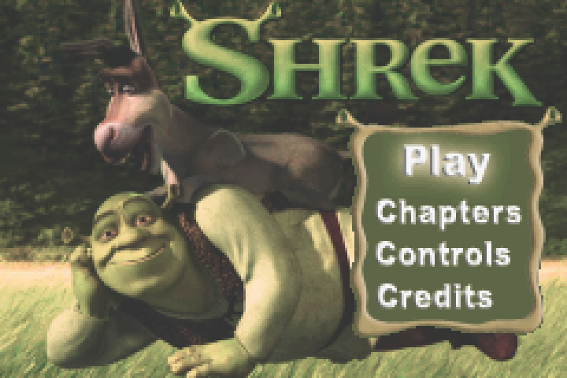

<p align="center">
  
</p>

<h1 align="center">ShrekGBAVideoRecomp — Shrek, Recompiled</h1>

> _This recompilation is a **byproduct of developing
> [gbarecomp](https://github.com/mstan/gbarecomp)** — the games (and, apparently,
> movies) are the proving ground; the framework is the goal.
> **This is an in-development preview, not a finished port — expect rough
> edges.** Contributions are welcome: testing, issues, and PRs to the Movie Pak
> or framework all help._

Static recompilation of **Shrek Movie** (Game Boy Advance Video, USA) to native
PC, built on [`gbarecomp`](https://github.com/mstan/gbarecomp) with the shared
[`recomp-ui`](https://github.com/mstan/recomp-ui) launcher.

> ### Status — movie playback, fully static on the validated route
>
> Shrek boots through the real recompiled GBA BIOS, reaches the menu, and starts
> movie playback. The cold-cache 600-frame acceptance route reports
> **`dispatch_misses=0` and `interpreted_insns=0`**: no interpreter and no JIT
> fallback. The boot code, relocated EWRAM player, and IWRAM interrupt handlers
> all run as statically recompiled native code.
>
> A complete 360,000-frame endurance route is included but remains opt-in. The
> software movie decoder currently runs substantially slower than real time
> after the opening sequence, so full-film performance and validation are still
> active work.

---

## What makes this one weird

This is a **64 MiB GBA Video Movie Pak**, twice the normal GBA ROM address
window. Its Matrix Memory cartridge controller pages compressed video data
through a small aperture. `gbarecomp` models that mapper natively, allowing the
recompiled player to reach the cartridge's second 32 MiB half.

The validated playback route performs more than 51 Matrix mapping commands,
reaches physical ROM data above `0x0335BE00`, and finishes with zero unmapped or
unhandled accesses.

## What "static recompilation" means here

The Movie Pak's **ARM7TDMI machine code is translated ahead of time to native
C**. The original boot code, RAM-relocated movie player, and interrupt routines
become generated native functions. The GBA BIOS is recompiled and executed too,
rather than replaced with high-level emulation.

The rest of the hardware — graphics, audio, DMA, timers, keypad, and the Matrix
Memory mapper — is provided by the `gbarecomp` runtime. The validated playback
route uses **no interpreter**. Generated translation is intentionally omitted
from Git because it derives from the copyrighted ROM; build tools regenerate it
from your own dump.

## Required inputs

| Input | Local path | SHA-1 |
|---|---|---|
| Shrek Movie (USA, `MSKE`, revision 5) | `roms/shrek_movie_usa.gba` | `2dedea86ec289a0e31089299613d9f74cca03609` |
| Game Boy Advance BIOS | `gbarecomp/bios/gba_bios.bin` | `300c20df6731a33952ded8c436f7f186d25d3492` |

The runtime refuses unrecognized inputs. This repository contains neither file;
you must supply your own legally dumped cartridge image and BIOS.

## Quick start

1. Clone this repository with its submodules.
2. Place the verified ROM and BIOS at the paths above.
3. Build using the instructions below.
4. Run `build/ShrekMovieRecomp.exe`.
5. Press **A** on **Play**, because we have somehow recompiled a movie.

`recomp-ui` provides the pre-boot launcher and in-game settings. It remembers
your local ROM and BIOS selections after the first launch.

## Controls

| GBA button | Keyboard |
|---|---|
| D-Pad | Arrow keys |
| A / B | Z / X |
| L / R | A / S |
| Start | Enter |
| Select | Backspace |

Save states use **Shift+F1–F9** to save and **F1–F9** to load.

## Enhancements and mods

- Optional sharp integer scaling improves presentation on modern displays.
- The normal `recomp-ui` settings are available before and during playback.
- Data-only `.gbamod` packages are supported under the stable target ID
  `shrek-movie-us`.

Mods must target the verified ROM SHA-1 above. Native behavior remains
game-owned and trusted: packages can activate only plugin IDs compiled into the
runner. ROMs, decoded frames, audio, and other copyrighted cartridge data must
not be packaged.

## Building from source

**Windows prerequisites:** CMake 3.20+, Ninja, an MSYS2 MinGW64 compiler, and
SDL2.

```powershell
git clone --recurse-submodules https://github.com/mstan/ShrekGBAVideoRecomp.git
cd ShrekGBAVideoRecomp

cmake -S gbarecomp -B gbarecomp/build -G Ninja
cmake --build gbarecomp/build --target gba_recompile

# Generate the ignored ROM translation and recompiled BIOS output.
pwsh tools/regen.ps1

cmake -S . -B build -G Ninja -DCMAKE_BUILD_TYPE=Release
cmake --build build --target ShrekMovieRecomp
```

The generated translation unit is large; expect the first build to take a
while.

## Playback validation

The headless smoke route runs 600 frames, validates static coverage and Matrix
mapping, and captures a screenshot:

```powershell
pwsh tools/test-playback.ps1
```

The opt-in complete-film route is:

```powershell
pwsh tools/test-full-movie.ps1
```

The long route represents roughly the duration of the film at 60 GBA frames per
second and is intentionally excluded from routine regression runs.

## Legal

This project contains **no ROM, Nintendo BIOS, decoded movie frames, audio, or
other cartridge content**. You must supply your own legally dumped inputs.

Shrek and related names and artwork are trademarks or copyrights of their
respective owners. Nintendo and Game Boy Advance are trademarks of Nintendo.
This project is an unaffiliated, non-commercial preservation and research
effort.

---

Built with [`gbarecomp`](https://github.com/mstan/gbarecomp), because the Game
Boy Advance was technically a video platform.
